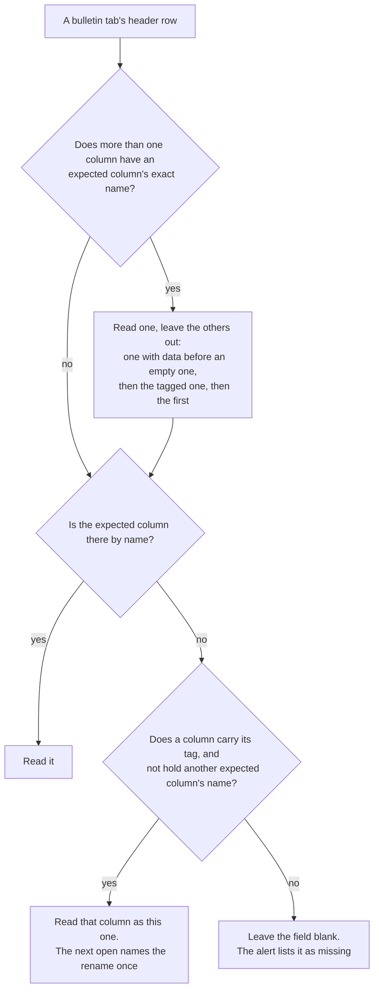

# Bulletin Spreadsheet Tags: Rename-Proof Tabs and Columns

## Purpose

The bulletin spreadsheet is the church's working database. People rename tabs, add
columns, move them, copy tabs, and undo their mistakes, and the sheet will grow to
cover more fellowships and calendars. None of that may take the bulletin down (#580).

This document owns the rules the Apps Script uses to find the tabs and columns it reads
after people change them, and the changeovers it keeps for older apps: the reasons for
each rule, and every edge case known so far, each with the test that holds it. It's
written for whoever changes that code next.
[Bulletin automation](../operations/bulletin-automation.md#columns-are-read-by-name)
says what the people running the spreadsheet need to know, and owns the procedures,
such as changing a header in the code.

PR #586 built two of #580's three parts: finding a renamed tab or column (item 1), and
a bulletin without its schedule instead of an error (item 3). Item 2, keeping an older
way of answering for older apps and retiring it once none is left, is in
[Changeovers](#changeovers).

**Status:** the rules are tested against a fake spreadsheet that models developer
metadata, and the Apps Script calls were checked against Google's documentation. The
first open after the 1.6.0 deploy is the first test on the live spreadsheet.

## Principles

In order of priority. When two conflict, the earlier one wins.

1. **The spreadsheet belongs to the people who edit it.** The scripts adapt to the sheet,
   never the reverse. Until #558 the scripts expected every header in a fixed order:
   one changed header stopped the whole bulletin and the open-time upkeep, and a rule on
   each header cell rejected any other name. Never go back to an all-or-nothing
   contract.
2. **A problem blanks one field, never the whole bulletin.** A missing column leaves its
   field empty; a missing schedule leaves the roster empty. The rest still loads.
3. **Anything a person does, a person can undo from the Sheets menus.** Sheets has no
   menu for developer metadata, so nobody can see a tag, or remove one except by
   deleting its column or tab. A rule that only a script could undo is a trap.
4. **Say what the scripts did, once.** Staff learn that a rename took, or that two
   columns share a name, without being nagged. The alert explains itself in English
   and Simplified Chinese.
5. **No extra cost while nothing is wrong.** While every expected name is in place once,
   no API request or printed bulletin reads a tag, so it makes no extra Sheets calls.
   The open-time upkeep reads them on every open.
6. **An app only sees what it can explain.** A response an app version doesn't
   understand goes only to versions that do (`appVersion`).

## Terms

| Term | Meaning |
| --- | --- |
| **Bulletin tab** | One of `BULLETIN_TABS`: `Sabbath Calendar`, `Weekly Data`, `Name Dictionary`, `Leadership`. All four are tagged |
| **Expected column** | A header in `BULLETIN_SHEET_COLUMNS`. Only `Sabbath Calendar` and `Weekly Data` have them, so only their columns are tagged. `Leadership` is read by the words `Pastors` and `Elders` in a header that holds only the title, and `Name Dictionary` by position |
| **Repeated column** | A `Sabbath Calendar` header that appears on both sides, such as `Offering Prayer`. Its side, Queens or Brooklyn, is its *location*: columns left of `Brooklyn Sermon` are Queens |
| **Label** | An expected column's name with its location, such as `Brooklyn Offering Prayer`; for other columns, the header itself |
| **Tag** | Developer metadata with `DOCUMENT` visibility. A tab carries `bulletin.tab` with a value such as `sabbath-calendar`. A column carries `bulletin.column` with its label in lower case, such as `brooklyn offering prayer`, on the whole column (such as `C:C`) |
| **Tagged** | The spreadsheet has been opened since the deploy that added tags, so what the scripts found by name then carries its tag |
| **Effective headers** | The header row as the scripts read it, after the rules below: a renamed column's header replaced by its label, and the unread one of two same-named columns left out |
| **Upkeep** | What each open does first: [open-time steps](../operations/bulletin-automation.md#header-protection-and-validation-automation) 1 to 8, from header protection to tagging. `onOpen` builds the menu first, checks the `Hymn Bank` with any time left (step 9), and shows the alert last (step 10) |
| **Readers** | Everything that reads the bulletin tabs: the API, the printed bulletin, the [roster checks](../operations/bulletin-automation.md#roster-conflict-highlights-and-unknown-names), the [English-only guard](../operations/bulletin-automation.md#english-only-sabbath-calendar-input), the upkeep's quarter rows, `Weekly Data` repair, and row hiding (steps 4 to 6), and the alert |

**Sources:** the lookup is in `google-apps-script/BulletinApi.gs` (`BULLETIN_TABS`,
`BULLETIN_SHEET_COLUMNS`, `getBulletinSheet_`, `resolveBulletinHeaders_`). The
tagging is `tagBulletinTabsAndColumns_` in `BulletinScheduleMaintenance.gs`, and the
alert is `onOpen` with `takeNewBulletinRenames_` in `PrintedBulletin.gs`. The tests are
in `test/apps-script-bulletin-resilience.test.ts`.

## How a tab is found

`getBulletinSheet_(spreadsheet, name)` returns the tab the scripts read as `name`:

1. **By name.** A tab with that exact name (`getSheetByName`, which returns the leftmost
   if there were ever two).
2. **By tag.** Otherwise, the first tab, in tab order, carrying the name's tag. This is
   a renamed tab.
3. **By an earlier name.** Otherwise, a tab with one of the `earlierNames` listed for it
   in `BULLETIN_TABS`, for when the code itself renames a tab. Every list is empty
   today.
4. Otherwise, nothing: the tab is missing.

`isBulletinTab_(sheet, name)` asks the same question from an edit's side, so the
English-only guard and the roster checks run on a renamed `Sabbath Calendar` too.

## How a column is found

`resolveBulletinHeaders_(sheet, sheetName, headers)` turns a tab's header row into its
effective headers. Every reader goes through it.

In detail:

1. **Ties.** When more than one column has an expected column's exact name, after
   trimming, collapsing spaces, and ignoring case, one is read and the others are left
   out of the effective headers. A column with anything below its header beats an empty
   one; among those left, the tagged one wins, and otherwise the first. A repeated
   column is meant to appear once on each side, so its copies are compared on their
   own side of `Brooklyn Sermon`, once the other columns' ties and renames have put a
   renamed `Brooklyn Sermon` back (step 4). Without a
   `Brooklyn Sermon` column, or when a header is named with its location, they aren't
   compared. Only the exact name counts: `English Hymn of Praise` and `Chinese Hymn of
   Praise` are alternatives for `Hymn of Praise`, not duplicates of it. Checking for
   data costs one read per tied column, only when there's a tie.
2. **The name comes first.** An expected column found by its name is read, wherever it
   is.
   - `Weekly Data` also accepts each column's alternatives in
     `BULLETIN_COLUMN_ALTERNATIVES`, and a header that starts with the name and has more
     text after a space, such as a translation.
   - A repeated column is found by its label anywhere in the row, such as a header
     typed as `Queens Offering Prayer`. Otherwise, by its plain name on its side of
     `Brooklyn Sermon`. Without a `Brooklyn Sermon` column, the first copy is Queens's
     and the second Brooklyn's.
3. **Then the tag.** Only an expected column missing by name is looked for by tag. A
   tagged column whose header is now another expected column's name isn't read as
   this one: it's read as the column it's named for, unless that column is still
   there. Then the tie in step 1 reads the original, and the renamed column, left out,
   is found again here under its old role by its tag. So that this works for a
   repeated column's name too, the tag lookup runs again after the repeated columns'
   ties.
4. **Repeated columns last.** Non-repeated columns are resolved first, ties and
   renames, because `Brooklyn Sermon` decides which side each repeated column is on. A
   renamed `Brooklyn Sermon` is put back in the effective headers before the repeated
   columns look for their side.

A call reads the tags at most once, and only when step 1 finds a tie or step 3 has
something missing.

## How tags are kept

Each open runs the upkeep, unless another run holds its lock. Its last step,
`tagBulletinTabsAndColumns_`, tags what the scripts read. It runs even when an earlier
step stops the upkeep, such as on a `Sabbath Calendar` without its `Date` column.

- **Tabs.** The tab found by name carries its tag. A tag on any other tab is removed,
  such as on a copy of `Sabbath Calendar`. A renamed tab keeps the tag it has.
- **Columns.** Each expected column of `Sabbath Calendar` and `Weekly Data`, found
  through the effective headers, carries its tag, and the same tag on any other column
  is removed. So the tag follows the column that's read: to one made again under the
  name, but not to a newcomer that loses a tie.
- **Missing things aren't tagged.** A column or tab that can't be found has nothing to
  tag. The upkeep never guesses.
- **Failures don't stop anything.** The header row is protected, so an open by someone
  outside the technology group may not be able to write its tags. Each failed change is
  logged as `Could not update the tag of …` in the Executions log, and a later open by
  the group writes it. Nothing else waits on a tag.

`DOCUMENT` visibility, rather than `PROJECT`, keeps the tags readable by any Apps Script
project with access to the spreadsheet, should the bound script ever be replaced. A tag
that no expected column or tab uses any more, such as after the code renames a label,
is left alone; it's harmless, since nothing uses it.

## What staff are told

`onOpen`, after the upkeep, may show one alert:

- **Missing columns, on every open** ("Bulletin columns not found / 找不到周刊列"), until
  each is back. A column that still has its tag under a new name isn't missing.
- **Changes, once each** ("Bulletin tabs or columns changed / 周刊工作表或列有变动"),
  such as `Tab "Calendar 2026" is read as Sabbath Calendar`, `Sabbath Calendar:
  "Speaker" is read as Queens Sermon`, or `Sabbath Calendar: 2 columns are named Date;
  column B is read`. When columns are also missing, these lines follow the missing ones
  in the same alert.

`takeNewBulletinRenames_` keeps the lines already shown in the document property
`bulletin.renamesShown`, replaced on each open with the current list. A change undone
and later made again is shown again. Where document properties can't be read, every
open shows the lines.

## Edge cases

What people can do, what happens, and the test that holds it.

| What someone does | What happens | Test |
| --- | --- | --- |
| Nothing unusual | Every tab and column is read by name; no request reads a tag | reads no tags while every tab and column has its name |
| Renames a tagged tab | Read by its tag; the next open names it once | still reads a renamed Sabbath Calendar tab, and says so |
| Renames a tab before it was ever tagged | Not found. `Sabbath Calendar`: the bulletin has no schedule, and the upkeep skips every step but the tagging, which still tags the other tabs and their columns. `Weekly Data`: the next open makes a new one, while the `Sabbath Calendar` is intact. Renaming back works before that open; after it, move the content into the new tab, or delete the new tab first | cannot find a tab renamed before it was ever tagged; still tags what it finds when the upkeep stops early; sets a deleted or emptied tab up again, with its headers and examples (`apps-script-physical-bulletin`) |
| Renames `Name Dictionary` or `Leadership` | Read by its tag | finds the Name Dictionary and Leadership tabs after a rename |
| Renames `Weekly Data`, or one of its columns | Read by its tag; no new tab or empty column is added | doesn't make Weekly Data again, or add a column, after a rename |
| Copies a tab that has its name, and the copy carries the tag | The original, which has the name, is read; the next open untags the copy | reads the original tab, not a duplicate that copied its tag, and untags the copy |
| Copies a renamed tab, moves the copy to its left, and the copy carries the tag | Neither has the name, so the first tagged tab, the copy, is read, and both keep their tags. Give the original its name back | Not tested: rare, and Google doesn't say whether a copied tab keeps its tags |
| Renames a tagged column | Read by its tag; the next open names it once | reads renamed and moved columns as before, and says which were renamed |
| Inserts columns, or moves them | Nothing changes for the readers; a tag moves with its column ([Google](https://developers.google.com/workspace/sheets/api/reference/rest/v4/spreadsheets.developerMetadata)). On the `Sabbath Calendar`, keep `Date` and `Quarter` in A and B and add columns at the far right: the protection on `A:B` and the backup English-only rule on the first 25 columns go by position | reads renamed and moved columns as before, and says which were renamed (inserting; the fake spreadsheet can't move a column) |
| Deletes a column the scripts read | Its tag goes with it, and its field is blank. `Sabbath Calendar`: the alert lists it on every open until a column with its name is back. `Weekly Data`: the next open adds it back, empty | blanks a deleted column's field, lists it as missing, and drops its tag; puts a missing column back at the far right, and leaves the rest alone (`apps-script-physical-bulletin`) |
| Renames `Brooklyn Sermon` and a repeated column | Each repeated column stays on its side | keeps each side of a repeated header when Brooklyn Sermon is renamed too |
| Renames a column, then makes a new one with the old name | The new one, which has the name, is read; the next open moves the tag to it | reads a column made again under the old name, and moves the tag to it |
| Gives a second column an expected column's name | The original, which has data and the tag, is still read and keeps its tag; the next open names the tie once | reads the tagged column when a new column gets its name, and keeps its tag |
| The same, before anything is tagged | The first with data is read; the next open names it | reads the first of two columns with the same name when neither is tagged, and says which |
| Gives a third column a prayer column's name on that prayer's side | The original, with its data and tag, is still read; the next open names the tie on that side | reads the tagged prayer column when a new one on the same side gets its name |
| Renames a `Weekly Data` column before it was tagged, opens the sheet, then puts the old name back | The open added an empty column with the name and tagged it. The column with data is read, and the next open moves the tag to it. The empty one can be deleted | reads the column with data when an empty one an open added gets the same name |
| Has a hymn's English and Chinese columns | Both are read as before; not a tie | doesn't count a hymn's English and Chinese columns as the same name |
| Renames a tagged column to another expected column's name, after deleting that column | Read as the column it's now named for; the one it was is missing | doesn't read a tagged column that now has another expected column's name |
| The same, while that column is still there | The original keeps its name's role, and the renamed column keeps its old role, by its tag. The next open names both | keeps reading a renamed column in its old role when the name it took is still in use; keeps reading a column renamed to a prayer column on its side in its old role |
| Deletes the `Sabbath Calendar` or its `Date` column, or the Sabbath has no row | A 1.6.0 app gets the bulletin with "schedule isn't set"; older apps get the old error ([below](#the-missing-schedule-fallback)) | still gives the week when …, saying the schedule is not set; gives older apps the same error as before when … |
| Undoes a change | The sheet is as before, and the next open's notices follow it | announces each rename once |

Not yet seen in use, and so not designed for: cutting a column's cells and pasting them
into another column. The header's name still finds the column where it now is, and the
next open moves the tag to it, whatever happens to the old column's metadata.

## The missing-schedule fallback

Without the `Sabbath Calendar` tab, its `Date` column, or the Sabbath's row, the API
can still return the week's fixed content and `Weekly Data`, with the schedule blank
and `scheduleNotSet: true`. What the API, the app, and print do then is in
[Data precedence and fallback behavior](../operations/bulletin-automation.md#data-precedence-and-fallback-behavior).
The design choice is the version gate: only an app whose `appVersion` is at least
`SCHEDULE_NOT_SET_APP_VERSION` (`1.6.0`) gets it, since a blank bulletin with a note is
only better than an error for an app that can show the note. `isAppVersionAtLeast_`
accepts only numeric versions such as `1.6` or `1.6.0`. Older apps send no version, so
they, and the API's checks, get the error as before: an older app keeps its last copy,
and the checks still catch a broken sheet. The two kinds of response are cached apart.

## Decisions

**The name before the tag.** #580 proposed the tag first. With the tag first, a tab or
column made again under its old name, after a rename, would leave the renamed one in
use, and a copied tab could take over if it carried the tag. Nobody could fix either
from the sheet (principle 3). With the name first, the name staff see is what's read,
and the tag only fills in when nothing has the name.

**Data, then the tag, break a tie.** Name-first alone has one hole: a second column
with an existing column's name, such as a `Date` for another fellowship, would be read
if it came first, and the next open would move the tag to it, so the bulletin would
quietly show the wrong column. Preferring the tagged column keeps the original. Data
comes before the tag because an open can tag an empty column: the `Weekly Data` repair
adds one when a column was renamed before it was ever tagged, and a person putting the
old name back must get their data, not the empty column. Only exact names count, since
the hymn alternatives and translated headers are meant to coexist, and a prayer column
counts on its own side, where it's meant to appear once.

**Developer metadata, not something visible.** Named ranges show in a menu and any
editor can change or delete them, and a hidden row of IDs could be typed over or
sorted. A tag can't be seen or edited, and it moves with its column or tab, which is
what the lookup needs. The cost is principle 3: since nobody can remove a tag by hand,
the lookup must never let a tag outrank what people can see, except to break a tie.

**Tags on whole columns.** Developer metadata sits on a whole column (`C:C`), a whole
row, a tab, or the spreadsheet, not on one cell. A column's tag moves with it when
columns are inserted or moved, and is deleted with it.

**The upkeep tags only what it can find.** Only something found by name, or kept
through a rename, is tagged; it never guesses. A tab or column renamed before the first
open after the deploy stays untagged, and missing, until its name is put back.

## Changing this code

The procedures for changing a header the code expects, adding a column the scripts
should read, and keeping a `Weekly Data` column working through a rename are in the
[change checklist](../operations/bulletin-automation.md#change-checklist). What this
design adds:

- **A new expected name gets a new tag.** The first open after the deploy tags the
  column once it has that name. Until then, a `Sabbath Calendar` column is listed as
  missing, and a `Weekly Data` one is added empty by the next open. When staff then
  give the old column the new name, the tie goes to the column with data.
- **An old tag stays** after the code changes a label. It reads nothing.
- **Rename a tab in the code** by adding its old name to `earlierNames`.
- **Change a lookup rule** only with a test for the case that prompted it, and a row
  for it in the edge-case table, in the same PR. Keep "reads no tags while every tab
  and column has its name" passing: an ordinary request must make no metadata calls.
- **The fake spreadsheet** in the test file models developer metadata: tags move with
  inserted columns, are deleted with deleted ones, and a finder counts its calls. It
  can't move a column or cut and paste, so neither is tested.
- **Read the Executions log** after the deploy that changes this code. Each tag that
  couldn't be read or written is logged with `Could not …`.

## Learning from real use

The edge cases depend on people, so this design will change as they use the sheet:

1. **Watch the first opens after a deploy.** The open-time alert and the Executions
   log show whether tags were written and read; `verify-bulletin-api` and the daily
   external dependency monitor show the API still answers.
2. **Turn each surprise into an edge case.** When the bulletin shows the wrong thing
   after someone changed the sheet, find what they did, reproduce it with the fake
   spreadsheet, and only then change the rule, as above.
3. **Prefer telling staff over guessing.** When the scripts can't be sure which column
   is meant, read the safest one and say what they read, as with ties.
4. **Keep the principles.** A fix that needs a script to undo it, or that takes the
   whole bulletin down over one column, is the wrong fix.

## Changeovers

A changeover is an older way of answering that the API keeps, beside the new one, for
apps too old to handle the new one (#580 item 2). It's retired once no such app is
left. The first one is [the missing-schedule fallback](#the-missing-schedule-fallback):
apps before 1.6.0 still get an error for a missing schedule.

- **Marked in the code.** `BULLETIN_CHANGEOVERS` in `BulletinApi.gs` lists each one:
  an `id`, the app version that makes the old way unneeded (`retiresWith`), and what
  to remove (`cleanup`).
- **The script notes the last day an older app called.** `noteOlderAppCall_` runs on
  each bulletin request with a valid date. A request without `appVersion` is from an
  app older than 1.6.0, which didn't send one. For each changeover the app is older
  than, the script writes the day to the script property
  `bulletin.changeover.<id>.olderAppLastCalled`. A cache entry remembers the write
  for up to 6 hours, so the day is written a few times a day at most. The API's own
  checks send `client=check` and aren't counted, and neither is a version that isn't
  one. A failure here is logged and never stops the bulletin.
- **The status.** `?changeovers=1` returns each changeover with `olderAppLastCalled`,
  `watchedSince`, and `ready`. Watching starts the first time the status is read,
  which the monitor does daily once the script is deployed. A changeover is ready
  once 14 days (`CHANGEOVER_QUIET_DAYS`) have passed since the later of the two.
- **The cleanup issue.** The daily
  [external dependency monitor](../operations/external-dependency-monitor.md) reads
  the status and, for each ready changeover, opens **[changeover] Retire the bulletin
  API's `<id>` changeover**, once ever, with GitHub's own token
  (`scripts/bulletin-changeovers.cjs`). Its Priority starts at Low. When it can't read
  the status it only warns, since its own bulletin check already reports an API
  that's down.
- **The cleanup** removes the old way and its entry in one PR.

| What happens | Result | Test |
| --- | --- | --- |
| An app before 1.6.0, or one older than the mark, asks for a bulletin | The day is noted | notes the day an older app asks for a bulletin: … |
| Many older apps ask in one day | The day is written once while the cache remembers it, so at most once every 6 hours | writes the day once while the cache remembers it, however many older apps ask |
| A newer app, an API check, a version that isn't one, or a request without a valid date | Not noted | doesn't take … for an older app |
| Noting fails | The bulletin is still given | still gives the bulletin when … |
| The status is read for the first time | Watching starts, and nothing is ready for 14 days | starts watching the first time the status is read, so nothing is ready at once |
| No older app asks for 14 days | Ready, and the next monitor run opens the issue | is ready once no older app has asked for 14 days; opens a cleanup issue for each changeover the API says is ready, and only those |
| The issue was opened before, even if it's closed | Not opened again | doesn't open a changeover's issue again, even once it's closed |
| The live script predates changeovers, or the API is down | The monitor warns and opens nothing | only warns when it reads … |
| Phones that never update keep calling | The changeover never retires, and the old way stays | By design |
| Something other than the app calls without a version, such as a script someone runs by hand | Taken for an older app, which only delays the retirement | By design |

To see where each changeover stands, open the API's URL from
`constants/ExternalLinks.ts` with `?changeovers=1`.

### Changeover decisions

**The last day, not a count.** #580 planned a daily count of requests by version.
Requests run at the same time, so an exact count would need a lock on every request,
and a count without one loses updates. The rule only needs the last day an older app
called. Each write sets the day outright, with nothing read first, so requests at the
same time lose nothing that matters. A request that starts just before midnight can
save the earlier day after one that saved the new day, so the day can lag by one until
the next older app calls.

**A caller without a version counts as an older app.** Apps Script doesn't show a
web app its request headers, so a request without `appVersion` can't be told apart
from an app before 1.6.0. Erring this way can only delay a cleanup. The other way
could retire an answer a phone still needs.

**No Play Developer API.** Google Play has no public version lookup, and a Play token
in the public bulletin script would carry the deploying account's Play Console
powers. Store numbers would also miss phones that never update, which are the ones a
changeover is for.

**The status is public.** Like the bulletin, `?changeovers=1` needs no sign-in. It
shows only dates and the list in the code, which this repository already publishes.
